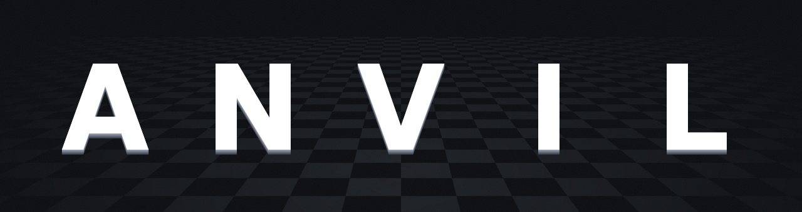

<h1 align="center"></h1>

A UCI chess engine written in Rust, with an NNUE evaluation trained only on its own
self-play games. Anvil has no GUI; use it from any UCI interface (Cute Chess, Arena,
Banksia, fastchess, ...).

## Features

**Search**
- Iterative deepening, principal variation search, aspiration windows
- Transposition table (4-entry buckets, 64 MB by default), backed by huge pages on Linux
- Null move pruning, razoring, reverse futility pruning, futility pruning, late move pruning,
  SEE pruning, ProbCut
- Late move reductions with history adjustment
- Singular extensions with multi-cut, internal iterative reductions
- Move ordering by TT move, SEE-scored captures, killers, history and continuation history
- Pawn-structure correction history for the static eval
- Quiescence search with SEE filtering
- Repetition and fifty-move draw detection

**Evaluation**
- NNUE `(768x4 -> 1024)x2 -> 1x8`: four king buckets with horizontal mirroring,
  SCReLU activation, eight output buckets by piece count
- Trained on 2.2B positions from Anvil's own self-play
- Incrementally updated accumulators with a per-king-bucket refresh cache
- AVX2 and AVX-VNNI paths selected at runtime, with a scalar fallback

## Strength

Tested at faster time controls because I am impatient.

These estimates are very rough because of the difference in time controls. They are
only meant to give a general idea of the engine's strength.

Matches against engines with a [CCRL Blitz](https://computerchess.org.uk/ccrl/404/)
rating. The estimate is the opponent's rating plus the measured Elo difference, so it
is approximate: these matches run at a different time control and on different
hardware than CCRL.

| Anvil | Opponent | CCRL Blitz | TC | Games | W / D / L | Elo diff | Estimate |
|---|---|---|---|---|---|---|---|
| 3.14.1 | Reckless 0.9.0 | 3767 | 20+0.2 | 1000 | 16 / 441 / 543 | -204 ± 16 | ~3563 |
| 3.14.1 | Stockfish 12 | 3656 | 20+0.2 | 1000 | 206 / 471 / 323 | -41 ± 16 | ~3615 |
| 3.14.1 | Booot 7.4 | 3651 | 20+0.2 | 1000 | 313 / 441 / 246 | +23 ± 16 | ~3674 |
| 3.14.1 | Cataphract 1.5.1 | 3651 | 20+0.2 | 1000 | 213 / 482 / 305 | -32 ± 16 | ~3619 |
| 3.14.1 | Prune 4.0.1 | 3644 | 20+0.2 | 1000 | 216 / 480 / 304 | -31 ± 16 | ~3613 |
| 3.14.1 | Black Marlin 9.0 | 3622 | 20+0.2 | 1000 | 322 / 478 / 200 | +43 ± 16 | ~3665 |
| 3.14.1 | Thrawn 3.2 | 3591 | 20+0.2 | 1000 | 410 / 408 / 182 | +81 ± 17 | ~3672 |
| **Average** | | | | | | | **~3632** |

Single thread for both engines, games played in colour-swapped opening pairs on an
AMD EPYC 9R14 server running 186 games at a time. Error bars are 95%, from W / D / L.

## Downloads

Binaries for Windows and Linux are on the
[releases page](https://github.com/AnvilFx/anvil-chess/releases):

- `x86-64-v3`: CPUs with AVX2 (Intel Haswell / AMD Zen and newer). Use this one if it runs.
- `x86-64-v2`: older x86-64 CPUs.

## Building

Requires a recent stable Rust toolchain.

```sh
cargo build --release
```

The binary is `target/release/anvil-engine` (`.exe` on Windows). The net is embedded,
so the binary is all you need.

`.cargo/config.toml` builds with `target-cpu=native`, which is fastest but may not run
on older CPUs than the build machine. For a portable binary, change it to
`target-cpu=x86-64-v3` (AVX2, most CPUs since 2015) or `x86-64-v2`.

## UCI

Supported `go` limits: `wtime`, `btime`, `winc`, `binc`, `movestogo`, `movetime`,
`depth`, `nodes`, `infinite`. Anvil searches with one thread.

| Option | Default | Range | |
|---|---|---|---|
| Hash | 64 | 1-32768 | Transposition table size in MB |

The other options (`RFPMargin`, `LMRBase`, `SEEQuietMargin`, ...) are search parameters
exposed for SPSA tuning. The defaults are the tuned values; leave them alone for play.

The non-standard `eval` command prints the static NNUE eval of the current position.

## The net

The net in `src/eval/net.nnue` is trained with
[bullet](https://github.com/jw1912/bullet) on 2.2 billion deduplicated positions from
Anvil's own self-play games, labelled with its own search scores and game results. No
other engine's data or evals are used.

- `tools/train/anvil.rs` is the bullet training config.
- `tools/train/anvil_dense.rs` and `nets/bullet-kb4-dense.json` are an experimental net with
  dense layers after the accumulator; the engine runs it with `DENSE = true` in `params.rs`.
- `tools/gen_net.py` quantizes a trained net into `net.nnue`. The header carries the
  quantization and bucket settings, so swapping in a net of the same shape needs no
  code changes.
- `nets/` holds the f32 weights and settings of the current net, so it can be
  regenerated:

```sh
python tools/gen_net.py nets/bullet-kb4-hl1024-2177m.bin nets/bullet-kb4.json src/eval/net.nnue
cargo build --release
```

A different hidden width or output bucket count also needs `N_HIDDEN` / `N_BUCKETS` in
`src/eval/params.rs`.

## Layout

```
src/
  chess/          the rules: board, move generation, bitboards, zobrist keys
    board.rs      position state, FEN, make/unmake
    movegen.rs    legal and noisy move generation, perft
  eval/           NNUE inference and the embedded net
  search/         the search
    mod.rs        Engine, limits, iterative deepening
    negamax.rs    root, negamax, quiescence, draw detection
    ordering.rs   move scoring and staged move picking
    history.rs    history tables and correction keys
    context.rs    per-search state
    see.rs        static exchange evaluation
    tt.rs         transposition table
    params.rs     tunable parameters and SPSA ranges
    tests.rs      search tests
  timeman.rs      time management
  uci.rs          UCI front end
nets/             f32 weights and settings of the current net
tools/            net quantizer and training config
```

## Testing

```sh
cargo test --release
```

## License

Licensed under either of [Apache License, Version 2.0](LICENSE-APACHE) or
[MIT license](LICENSE-MIT), at your option.
